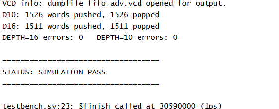
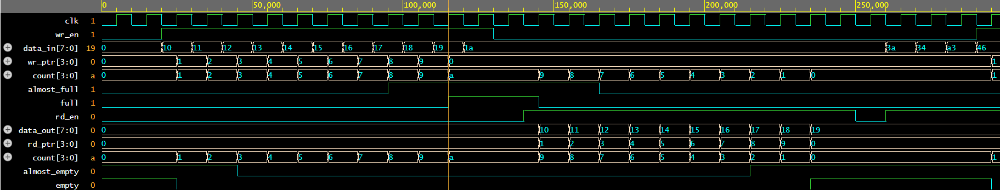
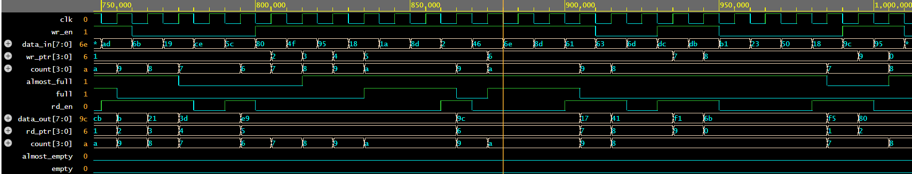

# Synchronous FIFO

A single-clock FIFO with full, empty, almost-full and almost-empty flags, written in Verilog and verified with a self-checking testbench.

## Features

- Parameterised depth (`DEPTH`), data width (`DATA_WIDTH`) and flag thresholds (`AF_THRESH`, `AE_THRESH`)
- Works with any depth, including non-power-of-2 depths such as 10, by wrapping the pointers explicitly at `DEPTH-1`
- Occupancy counter used for all four flags
- Writes ignored when full, reads ignored when empty
- Simultaneous read and write supported (count stays the same)
- Registered `data_out`

## Files

| File | Description |
|------|-------------|
| `design.sv` | Synchronous FIFO |
| `testbench.sv` | Self-checking testbench |

## Verification

The testbench runs two FIFOs in parallel, `DEPTH = 16` and `DEPTH = 10`. A reference model checks every output word and checks all four flags on every clock.

1. Fill: `DEPTH + 1` writes, the extra write must be ignored and `full` must be set
2. Drain: `DEPTH + 1` reads, the extra read must be ignored and `empty` must be set
3. 3000 cycles of random reads and writes, including simultaneous read and write

| Depth | Words pushed | Words popped | Errors |
|-------|--------------|--------------|--------|
| 16 | 1511 | 1511 | 0 |
| 10 | 1526 | 1526 | 0 |

Simulated with Icarus Verilog on EDA Playground.

## Results

### Simulation result

### Fill and drain (DEPTH = 10)

Ten words written until `full`, the extra write ignored, then all ten read back in order until `empty`.

### Random traffic and pointer wrap (DEPTH = 10)

`count` moves between 7 and 10 while `almost_full` (8 or more) and `full` (10) follow it. Both pointers wrap from 9 back to 0, which shows the non-power-of-2 depth working.

